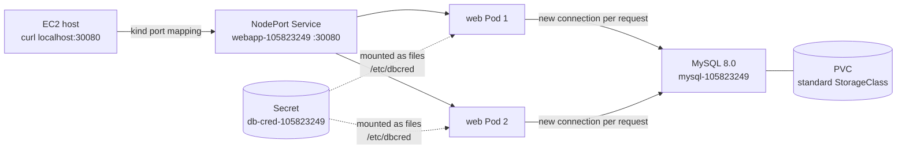

# Kubernetes Zero-Downtime Secret Rotation

Rotate a live database password on Kubernetes **without a single failed request**, and reverse the rotation on demand when the new credential is declared compromised.

A Flask web app on a 3-node [kind](https://kind.sigs.k8s.io/) cluster reads its MySQL credentials from a Kubernetes Secret. `rotate.sh` swaps the credential in the safe order (**add new → switch consumers → revoke old**) while `monitor.sh` sends one request per second and counts failures.

> CLO835 – Portable Technologies in Cloud, Seneca Polytechnic, Fall 2026 · Semester Project 12 · Tirth Dipakkumar Patel (105823249)

## Results from rehearsals

| Check | Result |
|---|---|
| Rotation v1 → v2 → v3 under 1 req/s load | 79 requests, **0 failed** |
| Rotation v1 → v2, rollback to v1, web Pod deleted mid-rollback | 646 requests, **0 failed** |
| `bootstrap.sh` from a fresh clone to a working curl | **137 seconds** (limit: 15 minutes) |

Transcripts are in [`evidence/`](evidence/).

## Architecture



Everything runs in namespace `rotation-105823249` on kind cluster `clo835-105823249` (1 control-plane + 2 workers).

## How zero downtime is achieved

- **Credentials are read from files on every connection.** The app never caches the password, so a Pod always uses whatever the Secret currently holds.
- **Both credentials are valid during the switch.** The new DB user exists before any Pod uses it, and the old user is dropped only after every Pod has moved over.
- **Rolling update with `maxUnavailable: 0`, `maxSurge: 1`.** A new Pod starts and must pass its readiness probe before an old Pod is removed, so two Pods are always serving.
- **The readiness probe touches the database.** `/healthz` runs `SELECT 1` with the mounted credential, so a Pod with a broken credential never receives traffic.
- **Graceful shutdown.** A `preStop` sleep keeps a terminating Pod serving while it is removed from the Service, and gunicorn finishes in-flight requests on SIGTERM.
- **Deterministic cutover.** The Deployment is restarted instead of waiting for the kubelet to sync the mounted file, so `rollout status` shows exactly when it is safe to revoke the old user.

## Quick start

Requires only Docker, kind and kubectl on a Linux host.

```bash
git clone https://github.com/TDPATEL1224/k8s-zero-downtime-secret-rotation.git
cd k8s-zero-downtime-secret-rotation
./bootstrap.sh                 # cluster, MySQL, seed data, app, smoke test

./monitor.sh                   # terminal 1: 1 req/s, prints total= failed=
./rotate.sh v2                 # terminal 2: rotate, pauses before dropping v1
```

Rollback, revocation proof, and every other procedure are in [`runbook.md`](runbook.md).

## Repository layout

```
app/                         Flask app (/ and /healthz), Dockerfile, requirements
manifests/
  kind-config.yaml           1 control-plane + 2 workers, port 30080 mapped to host
  namespace.yaml
  mysql.yaml                 PVC + Deployment (mysql:8.0) + ClusterIP Service
  mysql-seed-job.yaml        creates DB, 3 seeded rows, user v1
  webapp.yaml                Deployment (2 replicas, readiness, Secret file mount) + NodePort
  webapp-envvar-variant.yaml comparison only, never deployed: Secret via env vars
.github/workflows/           builds and pushes the app image to Docker Hub (no cluster access)
bootstrap.sh                 everything from a clean host
rotate.sh                    create user → update Secret → roll → verify → pause → drop
monitor.sh                   availability monitor with failure counter
runbook.md                   tested, copy-paste procedures for the live demo
evidence/                    terminal transcripts from rehearsals
```

## Constraints followed

- Raw YAML and kubectl only: no Helm, no kustomize.
- Runs entirely inside kind on an EC2 host: no EKS, no managed AWS services.
- Images: `mysql:8.0` from Docker Hub and the app image `tdpatel12/clo835-project12-webapp`, built by GitHub Actions.
- The GitHub Actions workflow only builds and pushes; it never contacts the cluster.
- No passwords in the repository: they are generated with `openssl rand -hex 12` at run time and written only to Kubernetes Secrets and MySQL.

## Tech stack

Kubernetes (kind v0.29, Kubernetes v1.33) · MySQL 8.0 · Python, Flask, PyMySQL, gunicorn · Docker · GitHub Actions · Bash · AWS EC2
